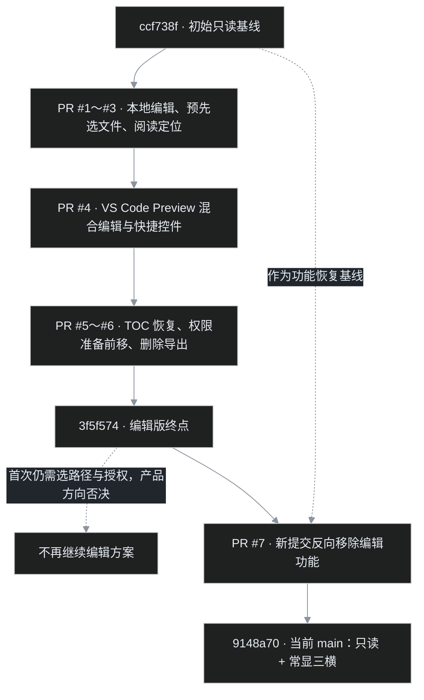
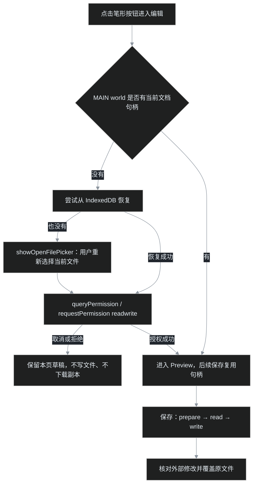
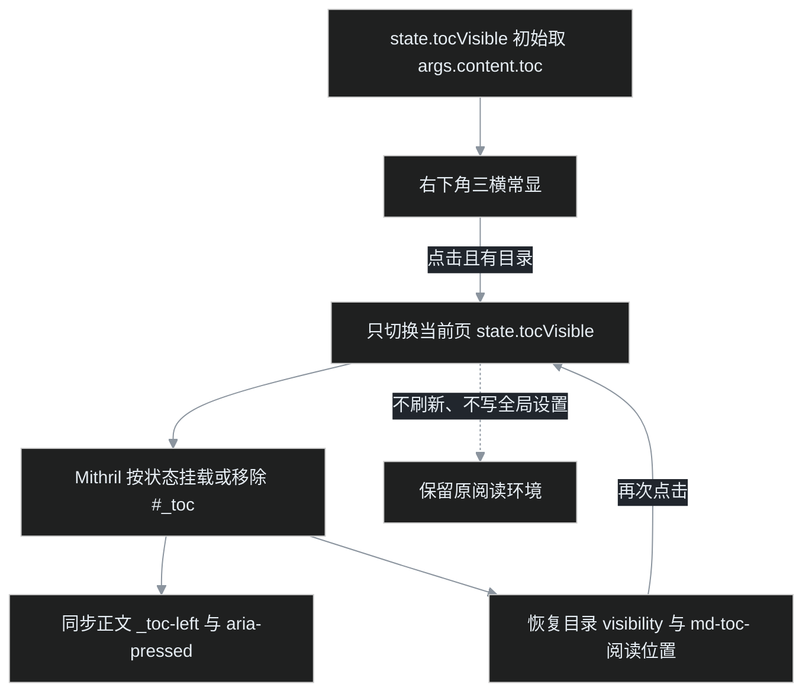

# 二次开发日志：Preview/Edit 与常显极简 TOC

> 记录范围：`yeyangchen2009/markdown-viewer` 自用 fork，2026-11-13 至 2026-11-14。上游为 `simov/markdown-viewer`，初始 fork 基线为 `ccf738f`。本文不记录另一个上游 `markdown-viewer/markdown-viewer-extension` 的 TypeScript 扩展。

## 一、版本结论与演进关系

本仓库先在同一条 main 上完成了六个编辑功能 PR，再通过 PR #7 用新提交恢复初始只读源码，并加入常显三横。它不是从初始提交另切一条长期并行的极简分支，也没有 reset 或改写历史。

| 版本 | 提交范围 | 主要结果 | 当前关系 |
|---|---|---|---|
| 初始上游版 | `ccf738f`，上游 5.3 之后 | Mithril 阅读页、主题、TOC、raw、公式、图表、自动刷新和阅读位置 | 最终功能恢复的基线 |
| Preview/Edit 版 | `58aaa2b` → `3f5f574`，PR #1～#6 | textarea 编辑演进为 VS Code 组件的 Preview 混合编辑，具备本地授权、句柄恢复与原文件写回 | 历史完整保留，当前源码已移除编辑器 |
| 常显极简 TOC 版 | `9148a70`，PR #7 | 反向移除编辑、保存、授权等改动，只增加右下角常显三横控制当前页 TOC | 已 squash 合并进 main，是当前产品版本 |



当前 main 相对初始基线只有四个功能差异文件：`README.md`、`content/index.css`、`content/index.js`、`content/scroll.js`。历史中的 `content/editor.js`、文件写入桥、hybrid 编辑器、字体、依赖和专项测试资产不属于当前源码。

## 二、初始上游项目的目录与文件功能

以下是 `ccf738f` 的关键结构。项目当时采用浏览器直接加载的 JavaScript、Mithril 视图和构建期第三方资源，不是另一个仓库的 TypeScript 多平台架构。

```text
markdown-viewer/
├── manifest.chrome.json          # Chrome/Chromium 扩展清单
├── manifest.firefox.json         # Firefox 扩展清单
├── build.sh                      # 上游构建入口
├── README.md                     # 安装、设置与渲染能力说明
├── CHANGELOG.md                  # 上游版本历史
├── firefox.md                    # Firefox 特定说明
├── background/
│   ├── index.js                  # 后台初始化与消息入口
│   ├── inject.js                 # 向匹配的 Markdown 页面注入阅读器和内容脚本
│   ├── detect.js                 # Markdown 路径与内容检测
│   ├── compilers/
│   │   ├── markdown-it.js        # markdown-it 编译适配
│   │   ├── marked.js             # marked 编译适配
│   │   ├── remark.js             # remark 编译适配
│   │   └── ...                   # commonmark、remarkable、showdown 等备选编译器
│   ├── messages.js               # 编译、raw、主题等消息分发
│   ├── storage.js                # 设置和页面状态存储
│   ├── webrequest.js             # Web 请求与 Content-Type 相关处理
│   └── xhr.js                    # 文档读取、刷新和本地请求支撑
├── content/
│   ├── index.js                  # Mithril 阅读页：状态、正文、raw、TOC 与主题 DOM
│   ├── index.css                 # 正文、TOC、按钮、宽度、滚动条和打印样式
│   ├── scroll.js                 # 正文及 TOC 阅读位置保存与恢复
│   ├── autoreload.js             # 本地/localhost 文档自动刷新
│   ├── mermaid.js                # Mermaid 图表渲染适配
│   ├── mathjax.js                # MathJax 公式渲染适配
│   ├── prism.js                  # 代码高亮适配
│   ├── emoji.js                  # emoji shortname 转换
│   ├── themes.css                # 阅读器公共主题变量与样式
│   └── anchor.svg                # 标题锚点图标
├── options/
│   ├── index.html / index.js     # 高级选项页和选项初始化
│   ├── settings.js               # 编译器、内容、主题等设置交互
│   ├── origins.js                # 远程来源访问控制
│   └── custom.js                 # 自定义主题处理
├── popup/
│   ├── index.html                # 浏览器工具栏弹窗结构
│   └── index.js                  # 当前文档快捷设置交互
├── icons/                        # 扩展与主题图标
└── build/
    ├── package.sh                # 扩展资源构建与打包脚本
    ├── package.json              # legacy 构建依赖与脚本
    ├── bootstrap/                # 第三方资源的获取/构建入口
    ├── markdown-it/ marked/ ...  # Markdown 编译器浏览器资源
    ├── mithril/ mermaid/ mathjax/# 视图、图表和公式运行时资源
    ├── prism/ remark/ mdc/ ...   # 高亮、编译与界面支撑资源
    └── themes/                   # 可选阅读主题资源
```

初始阅读链路可以概括为：`background/inject.js` 注入页面，`content/index.js` 把 Markdown 发给后台编译器，取得 HTML 后交给 Mithril 重建正文；Prism、Mermaid、MathJax 按设置追加渲染，`content/scroll.js` 恢复正文与目录的位置。极简版应在这条链路内增加目录开关，而不是引入编辑器框架。

## 三、版本一：参照 VS Code 增加 Preview/Edit

### 3.1 演进过程

| 时间 | 合并提交 / PR | 主要改动 |
|---|---|---|
| 2026-11-13 | `58aaa2b` / #1 | 增加本地 Markdown 编辑、dirty 状态、保存期间输入保护、外部修改冲突处理与原文件写回 |
| 2026-11-13 | `1ee2634` / #2 | 进入编辑时预先选择当前本地文件并准备句柄，不把保存时才弹选择器当作理想流程 |
| 2026-11-14 | `b91733b` / #3 | 进入编辑时定位当前阅读位置，降低阅读态与编辑态切换的断裂感 |
| 2026-11-14 | `007040a` / #4 | 用 `@vscode/markdown-editor@0.0.2-179` 替换 textarea；活动块编辑精确源码，非活动块保留渲染；增加右下快捷控件 |
| 2026-11-14 | `17748ed` / #5 | 修复 Mithril 重建 TOC 后目录实际可见状态未恢复的问题，保留目录阅读位置 |
| 2026-11-14 | `3f5f574` / #6 | 新选与恢复句柄都提前确认 `readwrite`；保存按 prepare → read → write；删除导出/下载路径，精简提示 |

Preview 的权威源文是 `model.sourceText`，不是渲染 HTML 的反向转换。任务框、undo/redo、中文输入和 Mermaid 在混合编辑组件内工作；完整阅读态仍保留原来的 Markdown 编译、raw、主题和自动刷新链路。

### 3.2 主要改动代码处

这些文件在当前 main 已删除，链接固定到编辑版终点 `3f5f574`，用于追溯历史，不应按当前工作区查找。

| 历史代码位置 | 职责与关键改动 |
|---|---|
| [`content/hybrid-editor.js:2`](https://github.com/yeyangchen2009/markdown-viewer/blob/3f5f574/content/hybrid-editor.js#L2-L129) | 创建 VS Code `EditorModel`、`EditorView`、`EditorController`；`sourceText` 保存完整 Markdown，连接输入与外部内容替换 |
| [`content/hybrid-editor.js:154`](https://github.com/yeyangchen2009/markdown-viewer/blob/3f5f574/content/hybrid-editor.js#L154-L181) | `revealSourceLine()` 将阅读位置映射到编辑器 Selection，并用有界 animation frame 校正异步布局 |
| [`content/editor.js:55`](https://github.com/yeyangchen2009/markdown-viewer/blob/3f5f574/content/editor.js#L55-L86) | 维护 `active/busy/saving/dirty/draft/disk/format/revision/external`，记录磁盘基线、BOM 与换行格式 |
| [`content/editor.js:88`](https://github.com/yeyangchen2009/markdown-viewer/blob/3f5f574/content/editor.js#L88-L139) | 进入编辑时并行准备句柄和读取源文件；取消连接仍允许本页编辑，退出时恢复最新预览 |
| [`content/editor.js:190`](https://github.com/yeyangchen2009/markdown-viewer/blob/3f5f574/content/editor.js#L190-L278) | 保存先 `prepare()`，再读盘核对外部变化，最后写入；保存期间的新输入继续保持 dirty，关闭前保护未保存草稿 |
| [`content/file-writer.js:21`](https://github.com/yeyangchen2009/markdown-viewer/blob/3f5f574/content/file-writer.js#L21-L43) | `ensureWritable()` 查询/请求 `readwrite`；`writeHandle()` 使用 `createWritable()`，失败时 `abort()` |
| [`content/file-writer.js:49`](https://github.com/yeyangchen2009/markdown-viewer/blob/3f5f574/content/file-writer.js#L49-L80) | isolated world 通过 DOM CustomEvent 发送文本请求，`prepare` 与 `save` 共用消息桥，不传活文件句柄 |
| [`content/file-writer-main.js:56`](https://github.com/yeyangchen2009/markdown-viewer/blob/3f5f574/content/file-writer-main.js#L56-L73) | MAIN world 按文档复用内存句柄、尝试 IndexedDB 恢复，首次调用 `showOpenFilePicker()` 并核对文件名 |
| [`content/file-writer-main.js:76`](https://github.com/yeyangchen2009/markdown-viewer/blob/3f5f574/content/file-writer-main.js#L76-L123) | 校验文档 URL、准备权限、首次精确文本核对、持久化句柄并写回原文件 |
| [`content/index.js:119`](https://github.com/yeyangchen2009/markdown-viewer/blob/3f5f574/content/index.js#L119-L182) | 阅读页连接 `prepare`、保存快捷键和编辑状态回调 |
| [`content/index.js:420`](https://github.com/yeyangchen2009/markdown-viewer/blob/3f5f574/content/index.js#L420-L468) | 右下角笔、三横、保存及冲突按钮；普通状态自动消退，保存和冲突保持可见 |
| [`build/hybrid-entry.js`](https://github.com/yeyangchen2009/markdown-viewer/blob/3f5f574/build/hybrid-entry.js) 与 [`build/build-hybrid.mjs`](https://github.com/yeyangchen2009/markdown-viewer/blob/3f5f574/build/build-hybrid.mjs) | 固定 VS Code 编辑器依赖并构建本地 IIFE、CSS、字体和第三方许可，运行时不依赖 npm 或外网 |
| [`docs/local-editor.md:15`](https://github.com/yeyangchen2009/markdown-viewer/blob/3f5f574/docs/local-editor.md#L15-L27) | 历史使用文档，明确首次选择、授权、句柄恢复、预览编辑与数据保护边界 |

`background/inject.js`、`background/messages.js`、`manifest.chrome.json` 和 `manifest.firefox.json` 也曾配合注入 MAIN world 写入桥、连接保存消息并声明脚本资源；这些编辑专用改动均在 PR #7 移除。

### 3.3 首次授权流程与产品否决

扩展知道当前 `file://` 地址，不代表浏览器授予它覆盖该路径的权限。首次写回必须让用户在系统选择器中重新选择当前文件，并明确允许写权限；内存 Map 与 IndexedDB 只能减少后续打断，不能消灭第一次交互。



编辑版并非没有跑通：PR #4 的真实 headed Edge E2E 已覆盖原生 picker、首次授权、第二次保存不选路径、刷新恢复与真实磁盘覆盖；PR #6 又验证了进入时授权、恢复后重新授权、权限状态与提示消退，Node 单测为 33/33。最终否决的理由是**首次选路径和授权的实际操作太麻烦**，阅读需求不需要为此长期承担编辑器、权限和保存冲突的复杂度。

Firefox 当时只完成静态构建与打包复核，未做实机安装验收。这个事实不影响“真实 Edge 编辑链路曾通过”的记录，也不能扩大成全浏览器验收。

## 四、版本二：恢复只读并加入常显三横

### 4.1 恢复方式与最终交互

PR #7 以 `ccf738f` 为功能基线，反向应用 PR #1～#6 的产品改动，通过新提交落到 `9148a70`，保留全部历史。随后只保留一个轻量入口：右下角三横常显，点击切换当前页 TOC，再点收起；不刷新页面，不写入 `chrome.storage`，也不改变全局 `toc` 默认设置。



与编辑版的自动隐藏快捷控件不同，最终三横不自动消失。即使全局 `toc=false`，当前文档也先生成目录，使用户可以临时展开；没有标题时按钮仍常显但 disabled。raw 模式不显示目录面板，正文、主题、Mermaid、MathJax、Prism、自动刷新与阅读位置继续走原实现。

### 4.2 当前主要改动代码处

以下链接对应当前只读终点 `9148a70`，不是已删除的编辑器历史。

| 代码位置 | 最终改动 |
|---|---|
| [`content/index.js:15`](https://github.com/yeyangchen2009/markdown-viewer/blob/9148a70/content/index.js#L15) | 新增页面级 `state.tocVisible`，初始值仍来自 `args.content.toc` |
| [`content/index.js:58`](https://github.com/yeyangchen2009/markdown-viewer/blob/9148a70/content/index.js#L58-L70) | `toggleToc()` 只切换当前页状态；`tocIcon()` 用三条 SVG path 构成图标 |
| [`content/index.js:130`](https://github.com/yeyangchen2009/markdown-viewer/blob/9148a70/content/index.js#L130-L150) | 每次渲染都生成 `state.toc`，全局默认关闭时也允许当前页临时展开 |
| [`content/index.js:208`](https://github.com/yeyangchen2009/markdown-viewer/blob/9148a70/content/index.js#L208-L227) | 按 `tocVisible` 挂载 `#_toc`、调整正文左边距；三横设置 title、aria-label、aria-pressed 和无标题 disabled |
| [`content/index.css:175`](https://github.com/yeyangchen2009/markdown-viewer/blob/9148a70/content/index.css#L175-L209) | 三横固定右下 20px、40×40px，提供焦点、disabled 与暗色样式；打印时隐藏 |
| [`content/scroll.js:109`](https://github.com/yeyangchen2009/markdown-viewer/blob/9148a70/content/scroll.js#L109-L120) | Mithril 重建目录后恢复真实 `visibility`，绑定并恢复 `md-toc-` 目录阅读位置 |
| [`content/scroll.js:121`](https://github.com/yeyangchen2009/markdown-viewer/blob/9148a70/content/scroll.js#L121-L148) | 保留正文位置和 hash 定位，只在当前页目录展开时调用 `restoreToc()`，raw 下隐藏目录 |
| [`README.md:185`](https://github.com/yeyangchen2009/markdown-viewer/blob/9148a70/README.md#L185-L189) | 补充常显三横只影响当前页、不刷新、不改全局默认的使用说明 |

原 `test/editor.test.js`、`test/extension.e2e.js` 等编辑专项资产随 PR #7 移除。最终验收使用独立的真实扩展测试驱动，而不是保留一套已经不在产品源码中的编辑器测试。

### 4.3 实际验证与交付边界

| 验证项 | 结果 |
|---|---|
| 真实 headed Edge persistent-context E2E | 1/1 通过，页面无未捕获异常 |
| 覆盖范围 | 目录反复开关、中文锚点、无刷新、全局 `toc=false` 不变、阅读位置、自动刷新、raw、明暗主题、无标题文档，以及编辑器/写入桥不存在 |
| 截图 | 明暗主题截图均人工目检 |
| 发布包审计 | Edge 与 Firefox ZIP 均通过 CRC、文件集合和编辑器残留负向审计 |
| Firefox | 未做实机安装验收 |
| 构建方式 | 使用官方 simov 5.3 Release ZIP 的 vendor/themes 基线覆盖构建，未宣称 legacy node-sass 完整上游构建成功 |

当前正式包为 `dist/edge-v5.3-readonly.zip` 与 `dist/firefox-v5.3-readonly.zip`，旧的 `*-editor.zip` 不再代表当前交付。

## 五、后续维护约束

1. **默认维护只读基线。** 不因为历史中存在编辑器就重新接入文件写入、授权和导出路径；旧提交只作追溯。
2. **三横只影响当前页。** 新增行为不能暗中写全局设置、刷新页面或让按钮再次自动隐藏。
3. **审查差异以 `ccf738f` 为基线。** 当前功能差异应保持集中在上述四个文件，避免把已移除的编辑器依赖重新带回发布包。
4. **验收口径分开写。** 真实 Edge、Firefox 静态构建、Release 覆盖构建是三类不同证据，不能互相替代。
