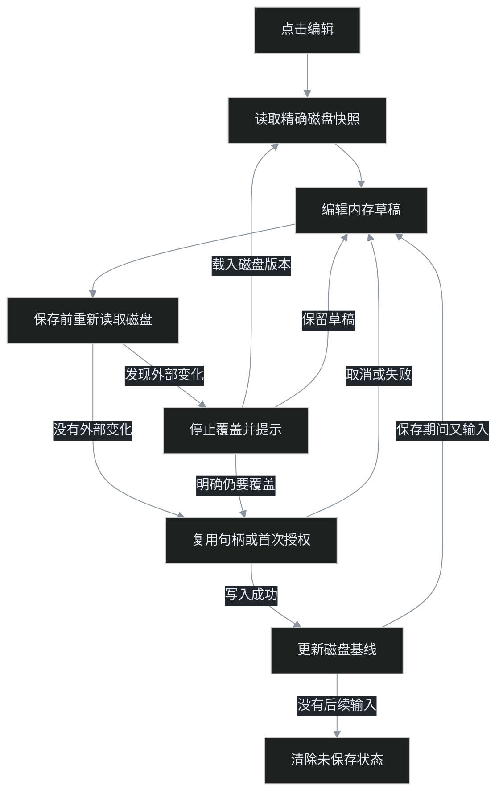

# 本地 Markdown 编辑与保存

## 使用

1. 在扩展详情页开启「允许访问文件 URL」；新版 Edge 还需开启站点访问中的 `file:///*`。
2. 打开本地 Markdown，点击右下角「编辑」。
3. 修改源码，按 **Ctrl/Cmd+S** 或点击「保存」。
4. 首次保存时，在系统对话框中选择**当前打开的同名文件**。浏览器必须取得一次明确授权，扩展不能从 `file://` 地址静默推导写权限。
5. 同一页面后续保存复用句柄，不再选择路径。刷新后优先从 IndexedDB 恢复句柄；浏览器不支持恢复时会重新要求选择，这是正常降级。首次写回时 Edge 还会显示一次「保存更改」权限提示，这是写入授权，不是「另存为」。

实现参照 VS Code 当前源码的两段路径：[`fileDialogService.ts`](https://github.com/microsoft/vscode/blob/main/src/vs/workbench/services/dialogs/browser/fileDialogService.ts) 通过 `showOpenFilePicker()` 取得文件句柄，[`htmlFileSystemProvider.ts`](https://github.com/microsoft/vscode/blob/main/src/vs/platform/files/browser/htmlFileSystemProvider.ts) 用内存 Map 与 IndexedDB 复用句柄，并在 `writeFile()` 中直接 `createWritable()`。本扩展同样由 `createWritable()` 让浏览器强制执行写权限，不自行绕过授权。

「退出编辑」保留内存草稿并显示最新预览。未保存时关闭或刷新页面会触发浏览器提示；「导出副本」始终只表示导出，不会显示为已保存原文件。



## 数据保护边界

| 情况 | 行为 |
|---|---|
| 自动刷新发现外部修改 | 编辑中或有草稿时只提示，不覆盖 textarea |
| 保存前发现外部修改 | 停止保存；强制覆盖需要再次确认 |
| 保存期间继续输入 | 只保存开始时的快照，后续输入保持未保存 |
| 用户取消、权限拒绝、写失败 | 保留草稿；写失败调用 `abort()`，不提交临时文件 |
| 本地写回不可用 | 明确报错，不自动下载副本 |
| 远程文档 / Firefox | 不显示原文件「保存」按钮；可编辑和「导出副本」 |

首版面向 **UTF-8 Markdown**，保留 UTF-8 BOM、LF 或 CRLF 及末尾换行。混合换行会统一为原文的主要换行格式；其他编码不承诺字节级往返。首次选择句柄时会核对文件名和磁盘文本，降低误选其他同名文件的风险，但浏览器不向扩展暴露完整路径。

## 测试

```bash
npm test
npm run test:e2e
```

E2E 依赖 `playwright-core` 和本机 Edge，使用 headed persistent context。可设置：

- `MV_EDGE_EXECUTABLE`：Edge 可执行文件；
- `MV_EXTENSION_DIR`：已构建扩展目录；
- `MV_E2E_WORK`：测试目录，默认 `F:\temp\simov-markdown-editor`；
- `PLAYWRIGHT_CORE_PATH`：复用其他本地安装的 `playwright-core`，避免重复下载。

Windows 测试驱动只向原生文件选择器输入临时副本路径。不得把 mock picker 的结果当作真实授权或真实磁盘覆盖。

## 在 Windows 上构建

上游 5.3 的完整 `build/package.sh` 仍依赖旧版 `node-sass`，在没有 Visual Studio C++ 工具链的新 Node 环境中会失败。可从 **simov 5.3 官方 Release** 下载同版本 `markdown-viewer-v5.3.zip`，保留其 vendor/themes，再覆盖本地源码：

```bash
python build/package-release.py F:/temp/simov-markdown-editor-build/markdown-viewer-v5.3.zip \
  --browser chrome \
  --work-dir F:/temp/simov-markdown-editor-build/chrome \
  --output F:/Data/markdown-viewer/dist/edge
```

脚本会核对 Release 与源码 manifest 版本，生成 `dist/edge-v5.3-editor.zip`，并校验 ZIP CRC 和文件集合。官方 Release 仅作为构建依赖基线，功能改动来自当前工作区。
